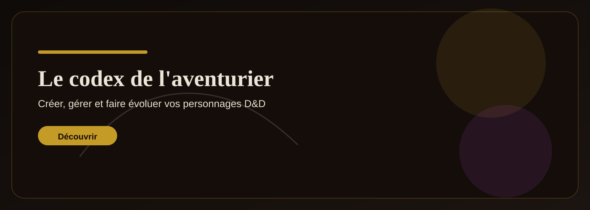
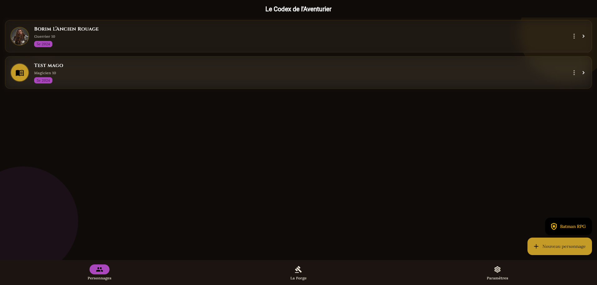
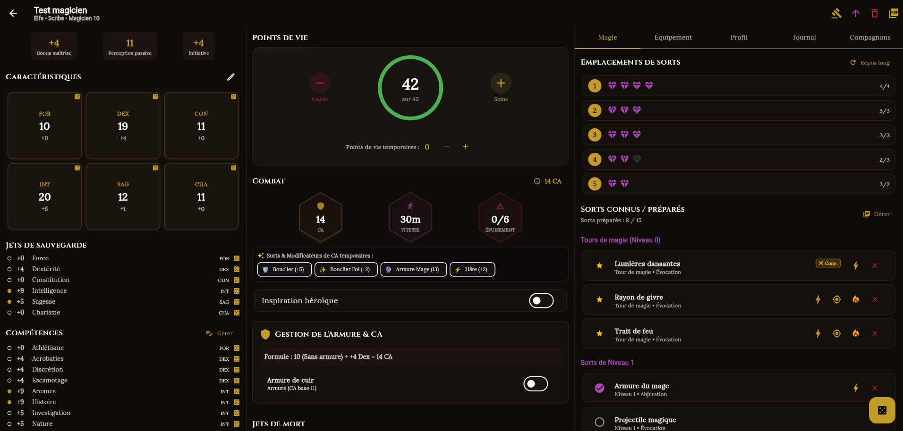
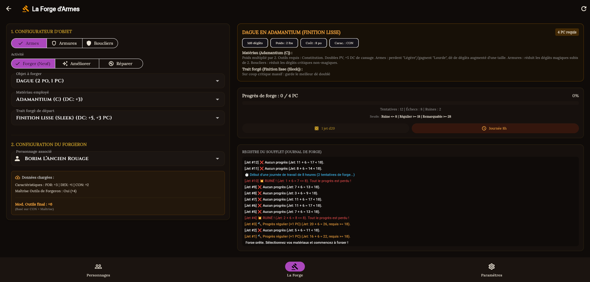

# Le Codex de l'Aventurier 🎲✨

[](LICENSE)
[](https://flutter.dev)
[](https://dart.dev)
[](https://github.com/Rahdidibu/dndCarac/releases)



**Le Codex de l'Aventurier** est une application moderne et réactive développée avec Flutter pour créer, gérer et faire évoluer vos personnages D&D 5e (Règles 2014 & 2024). L'application prend en charge la création guidée, les fiches interactives, le calcul dynamique de Classe d'Armure (CA), le lancer de combat en 1-clic, la bourse de monnaie automatique et la gestion des familiers/invocations.

---

## 🌟 Fonctionnalités Principales

- 🧙‍♂️ **Assistant de Création de Personnage Guidé** : Choix des règles (2014 / 2024), de la race, de la classe, de l'historique et répartition des caractéristiques.
- ⚔️ **Attaques Rapides & Lancer de Dégâts 1-Clic** : Jet de d20 (avec Avantage/Désavantage/Normal) + dégâts combinés avec détection des coups critiques (dés doublés) et échecs critiques.
- 🎯 **Traits d'Armes & Modificateurs de Jet** :
  - **Plage de critique élargie (19-20)** automatique ou manuelle.
  - **Relance automatique des 1 et 2 aux dégâts** (*Great Weapon Fighting* / Armes à deux mains).
  - **Armes Vicieuses** (+7 dégâts fixes en critique).
- 🛡️ **Calculateur Dynamique de Classe d'Armure (CA)** :
  - Ajustement automatique selon l'armure équipée, le bouclier et les bonus de Dextérité.
  - Modificateurs de sorts en 1-clic (🛡️ *Bouclier +5*, ✨ *Bouclier de la Foi +2*, 🔮 *Armure de Mage 13*, ⚡ *Hâte +2*).
  - Modal expliquant le détail complet du calcul de la CA.
- 💰 **Gestionnaire de Bourse de Monnaie** :
  - Saisie rapide, conversions automatiques de pièces (PO, PP, PA, PC), optimisation de la bourse et bouton de vidage sécurisé.
- 🐾 **Fiches de Familiers & Invocations** :
  - Ajout rapide de compagnons (Imp, Serviteur Invisible, Élémentaire de Feu, Loup, etc.) avec PV, CA et attaques intégrées.
- 🦇 **Univers Thématisés & La Forge** : Contenu spécial et assistant Batman/Forge.
- 🌐 **Multilingue (Français & Anglais)** & Mode Sombre Cyber-Fantasy.
- ☁️ **Authentification & Données Cloud** via Supabase.

---

## 📸 Aperçu





---

## 🛠️ Stack Technique

- **Framework** : [Flutter](https://flutter.dev) (Web & Android)
- **Langage** : [Dart](https://dart.dev)
- **Gestion d'État** : Riverpod 2.x
- **Base de Données Locale** : Drift (SQLite avec support IndexedDB pour le Web)
- **Backend** : Supabase (Authentification & Données Cloud)
- **Conteneurisation** : Docker & Nginx

---

## 🚀 Préréquis & Installation Local

### Préréquis
- Flutter SDK compatible avec [pubspec.lock](pubspec.lock) : Flutter `>=3.44.0`
  et Dart `>=3.12.0` pour les dépendances actuellement verrouillées
- Google Chrome ou un émulateur Android

### Installation

1. **Cloner le dépôt** :
   ```bash
   git clone https://github.com/Rahdidibu/dndCarac.git
   cd dndCarac
   ```

2. **Installer les dépendances** :
   ```bash
   flutter pub get
   ```

3. **Générer les fichiers de traduction** :
   ```bash
   flutter gen-l10n
   ```

4. **Configurer Supabase et lancer en local (Web)** :
   ```bash
   cp .env.template .env
   # Renseigner SUPABASE_URL et SUPABASE_ANON_KEY dans .env.
   ./run_local_chrome.sh
   ```

### Développement Web dans VS Code avec Dev Containers

Ce parcours lance l'interface en local et utilise un **projet Supabase hébergé**.
Le conteneur fournit Flutter `3.44.4`, Supabase CLI, Java 21, le SDK Android
(API 36, outils ADB et NDK du projet) et l'accès au Docker de l'hôte.
Il ne contient ni Chrome ni émulateur Android : le navigateur s'exécute sur
l'hôte et les tests Android utilisent un téléphone connecté.
La construction accepte les licences du SDK Android.

1. Installer Docker et l'extension VS Code **Dev Containers**, puis démarrer Docker.
   Si le réseau utilise un proxy HTTPS d'entreprise, copier ses certificats
   d'autorité approuvés (format PEM, extension `.crt`) dans
   [.devcontainer/certificates/](.devcontainer/certificates/) **avant** la
   construction. Ces fichiers locaux sont ignorés par Git et intégrés au magasin
   de confiance du conteneur. Ne jamais copier de clé privée.
2. Ouvrir le dépôt dans VS Code et exécuter **Dev Containers: Reopen in Container**.
   Après une modification du Dockerfile, utiliser **Rebuild Container**.
   La création restaure les versions de dépendances verrouillées et génère les
   traductions; le premier téléchargement du SDK peut être long.
3. Dans un terminal du conteneur, à la racine du dépôt :
   ```bash
   cp .env.template .env
   ```
   Renseigner l'URL du projet Supabase et sa clé **publique/publishable ou anon**.
   Ne jamais utiliser une clé `service_role`. Le fichier `.env` est ignoré par Git.
   Les constantes fournies à Flutter Web sont visibles dans le navigateur.
4. Dans le projet Supabase de développement, vérifier que les migrations de
   [supabase/migrations/](supabase/migrations/) sont appliquées et que
   l'authentification email/mot de passe est activée. Dans **Authentication >
   URL Configuration**, autoriser `http://localhost:8035` comme URL de site/de
   redirection pour les confirmations d'inscription. Utiliser un projet dédié
   aux tests plutôt que modifier les données de production.
5. Lancer **Flutter Web (devcontainer)** avec F5, ou exécuter :
   ```bash
   flutter run -d web-server --web-hostname=0.0.0.0 --web-port=8035 \
     --dart-define-from-file=.env
   ```
6. Ouvrir `http://localhost:8035` dans le navigateur de l'hôte, depuis l'onglet
   **Ports** si nécessaire. En session distante, utiliser l'URL effectivement
   transférée et l'autoriser aussi dans Supabase. Le serveur `web-server` a des
   capacités de débogage plus limitées que le périphérique Chrome.

Le fichier `.env` n'est pas lu automatiquement : le paramètre
`--dart-define-from-file` est indispensable. Après toute modification de `.env`,
arrêter puis relancer Flutter. Sans configuration/session Supabase, l'application
ne permet pas actuellement le parcours complet hors ligne.

Vérifications dans le conteneur :

```bash
flutter --version
flutter doctor
flutter analyze
flutter test
flutter build web --release --dart-define-from-file=.env
```

Les avertissements de `flutter doctor` sur Chrome et la chaîne Linux desktop
sont attendus; la chaîne Android doit être valide. Le port `8035` est transféré
automatiquement; les ports
`54321`/`54323` et Supabase CLI restent disponibles pour un éventuel backend
local, mais aucun service Supabase local n'est démarré dans ce parcours.
Le template [.devcontainer/.env.template](.devcontainer/.env.template) décrit
uniquement des variables de proxy; il ne remplace pas le `.env` applicatif racine.
En cas d'erreur `unable to get local issuer certificate`, vérifier les certificats
dans ce dossier puis reconstruire le conteneur; ne pas désactiver la
vérification TLS.

### Tester l'application Android depuis le Dev Container

Après cette évolution du Dockerfile, utiliser **Dev Containers: Rebuild Container**.
Le premier téléchargement du SDK/NDK peut prendre plusieurs minutes.

Sur Android 11 ou plus récent, connecter le téléphone au même Wi-Fi que le PC,
puis activer **Options pour les développeurs > Débogage sans fil**.
Ouvrir **Associer l'appareil avec un code d'association** et, dans le conteneur :

```bash
adb pair <IP>:<port-association>
# Saisir le code affiché sur le téléphone à l'invite ADB.
adb connect <IP>:<port-connexion>
adb devices -l
flutter devices
flutter run -d <identifiant-flutter> --dart-define-from-file=.env
```

Le port d'association et le port de connexion sont différents. Le second est
affiché sur l'écran principal du débogage sans fil; ils peuvent changer après
une reconnexion. Le réseau et le pare-feu doivent autoriser ces connexions depuis
le conteneur. La découverte automatique peut échouer sous Docker/WSL2 :
utiliser alors explicitement l'IP et le port. Aucun transfert USB ni port Docker
entrant n'est nécessaire.

#### Relancer une session de développement mobile

Depuis la racine du projet, dans le terminal du Dev Container :

```bash
adb connect <IP>:<port-connexion>
flutter run -d <IP>:<port-connexion> --dart-define-from-file=.env
```

Par exemple, avec l'adresse utilisée lors de la configuration initiale :

```bash
adb connect 192.168.1.10:43115
flutter run -d 192.168.1.10:43115 --dart-define-from-file=.env
```

Vérifier l'adresse et le port dans **Débogage sans fil** avant chaque session
et adapter les commandes s'ils ont changé. L'association avec `adb pair` n'est
à refaire que si l'autorisation a été perdue.

Pendant que `flutter run` reste ouvert, utiliser `r` pour le hot reload,
`R` pour redémarrer l'application et `q` pour arrêter la session.

Le fichier `.env` racine doit être configuré comme pour le Web. Le téléphone
doit pouvoir joindre Supabase. Ne pas enregistrer le code d'association ou les
clés privées ADB dans Git; une reconstruction peut nécessiter une nouvelle
association. Désactiver le débogage sans fil après les tests sur un réseau partagé.

Si l'installation échoue avec `INSTALL_FAILED_UPDATE_INCOMPATIBLE`, une version
signée avec une autre clé est déjà présente. Sa désinstallation permet
l'installation de développement, mais efface ses données locales : sauvegarder
ou synchroniser les données nécessaires avant de confirmer cette opération.

---

## 🐳 Déploiement Production (Docker & Raspberry Pi)

Le projet inclut des scripts de build automatisés dans le dossier `deploy/` :

1. **Compiler le Web & l'APK localement** :
   ```bash
   ./deploy/build_all.sh
   ```
2. **Déployer sur votre serveur / Raspberry Pi** :
   ```bash
   ./deploy/deploy.sh
   ```

Les conteneurs Docker utilisent Nginx optimisé avec compression Gzip, SSL et gestion de cache.

---

## 📄 Licence

Ce projet est sous licence **MIT**. Voir le fichier [LICENSE](LICENSE) pour plus de détails.
